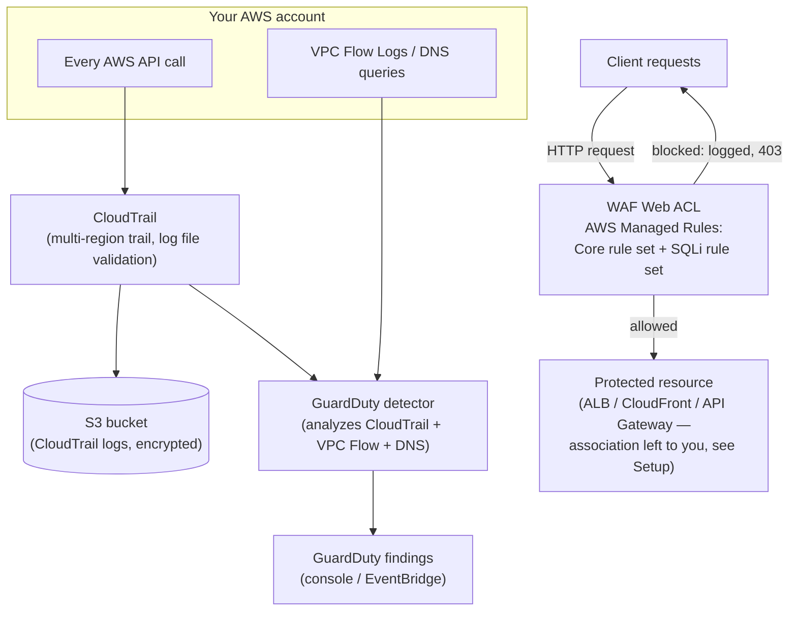

# AWS Security & Threat Detection

**GuardDuty** (intelligent threat detection), **CloudTrail** (who-did-what API audit log), and a **WAF Web ACL** with AWS Managed Rules (layer-7 filtering) — plus a clear, honest explanation of where **Shield** fits in, without deploying Shield Advanced (it costs **$3,000/month minimum** and is deliberately **not** included here). Built while studying the security/compliance portion of the **AWS Certified Cloud Practitioner (CLF-C02)** exam.

> ⚠️ **Status**: this Terraform configuration was hand-written against the AWS provider docs and reviewed manually; `terraform validate`/`apply` have **not** been run — this environment has no Terraform CLI or AWS credentials. Run it yourself following [Setup](#setup).
>
> 🚫 **This lab never enables AWS Shield Advanced.** Shield Advanced bills a **$3,000/month minimum commitment (1-year term)** — see [Shield Standard vs. Shield Advanced](#shield-standard-vs-shield-advanced) for why that's explained here but not deployed.

## Table of contents
- [Learning objectives](#learning-objectives)
- [What each service actually does](#what-each-service-actually-does)
- [Shield Standard vs. Shield Advanced](#shield-standard-vs-shield-advanced)
- [Use case](#use-case)
- [Architecture](#architecture)
- [Repository structure](#repository-structure)
- [Setup](#setup)
- [Testing — safe, simulated scenarios](#testing--safe-simulated-scenarios)
- [Cleanup](#cleanup)
- [Cost considerations](#cost-considerations)
- [Security notes](#security-notes)
- [Troubleshooting](#troubleshooting)
- [Limitations & future improvements](#limitations--future-improvements)
- [References](#references)

## Learning objectives

After working through this lab you should be able to:
- Explain what each of GuardDuty, CloudTrail, WAF, and Shield actually does, and correctly match a CLF-C02 exam scenario to the right one — these four get mixed up constantly.
- Explain the difference between **detection** (GuardDuty finds suspicious activity), **auditing** (CloudTrail records every API call for later review), and **prevention** (WAF blocks malicious requests before they reach your app).
- Generate **safe, AWS-provided sample findings** in GuardDuty without doing anything actually risky.
- Explain why **Shield Standard** needs zero setup and costs $0, while **Shield Advanced** is a significant, deliberate financial commitment — and why this repo only deploys the former (automatically, by existing) and explicitly avoids the latter.
- Read a CloudTrail event and a WAF-blocked-request log entry and explain what each field means.

## What each service actually does

| Service | Layer | What it does | What it does *not* do |
|---|---|---|---|
| **AWS CloudTrail** | Audit / logging | Records **every API call** made in your account (who, what, when, from where) to S3 — your account's audit trail. | Doesn't detect threats or block anything by itself — it's a record, not an alarm. |
| **Amazon GuardDuty** | Detection | Continuously analyzes CloudTrail events, VPC Flow Logs, and DNS logs with threat-intel feeds and ML to flag **suspicious behavior** (e.g. an EC2 instance suddenly talking to a known crypto-mining pool). | Doesn't block anything automatically — it raises findings; *you* (or an automated response you build) act on them. |
| **AWS WAF** | Prevention (layer 7) | Inspects **incoming HTTP(S) requests** to a protected resource (ALB, CloudFront, API Gateway) against rules (SQLi, XSS, rate limits) and blocks/allows at the request level. | Doesn't protect against infrastructure-layer (L3/L4) floods — that's Shield's job. |
| **AWS Shield** | Prevention (layer 3/4, + some L7 via Advanced) | Protects against **DDoS**. Standard: automatic, free, always-on for every AWS customer. Advanced: paid, adds near-real-time visibility, cost protection, and a DDoS Response Team. | Standard doesn't give you metrics/reports or a response team — that's what Advanced adds, at real cost. |

## Shield Standard vs. Shield Advanced

This is one of the most common CLF-C02 trick questions:

- **Shield Standard** protects **every** AWS customer, **automatically**, **for free**, against the most common network/transport layer (L3/L4) DDoS attacks. There is nothing to enable, configure, or deploy — it's always on. This lab's architecture is covered by Shield Standard the moment any resource in it exists, with zero Terraform needed.
- **Shield Advanced** is an opt-in, paid service: **$3,000/month minimum, 1-year commitment**, that adds detailed attack diagnostics, cost protection against scaling charges incurred during an attack, and 24/7 access to the AWS DDoS Response Team (DRT). It's aimed at large, internet-facing production workloads with real DDoS risk exposure.

This repository explains Advanced for the exam, and **deliberately contains zero Terraform for it** — there is no learning value proportional to committing $3,000/month in a study lab, and the brief this portfolio was built under explicitly requires never deploying resources with a real financial commitment like that without an explicit, separate decision by the account owner.

## Use case

A small internet-facing application needs: (1) a full audit log of account activity for incident investigation and compliance, (2) automated detection of suspicious account/network behavior without manually reviewing logs, and (3) filtering of common web attack patterns (SQL injection, XSS) before they reach the application.

## Architecture



## Repository structure

```
aws-security-threat-detection/
├── README.md
├── LICENSE
├── .gitignore
├── terraform/
│   ├── main.tf               # GuardDuty detector, CloudTrail + S3, WAFv2 Web ACL (Managed Rules)
│   ├── variables.tf
│   ├── outputs.tf
│   └── terraform.tfvars.example
└── scripts/
    ├── generate-sample-guardduty-findings.sh   # Uses AWS's own safe sample-findings API — zero risk
    └── test-waf-rules.sh                        # Sends a benign vs. an SQLi-pattern request, if associated
```

## Setup

**Prerequisites**: AWS account, [Terraform](https://developer.hashicorp.com/terraform/install) ≥ 1.5, AWS CLI v2 configured.

```bash
cd terraform
cp terraform.tfvars.example terraform.tfvars
# edit terraform.tfvars as needed

terraform init
terraform fmt -check
terraform validate
terraform plan
terraform apply
```

This creates: 1 GuardDuty detector (account-level), 1 multi-region CloudTrail trail + its S3 log bucket, and 1 **REGIONAL** WAFv2 Web ACL with the AWS Managed Rules `AWSManagedRulesCommonRuleSet` and `AWSManagedRulesSQLiRuleSet` attached, **not yet associated with any resource** (a Web ACL does nothing on its own — see below).

**To actually enforce the WAF rules**, associate the Web ACL with a protected resource, e.g. the ALB from [`aws-high-availability-web-app`](https://github.com/bboysendo/aws-high-availability-web-app) in this portfolio:
```bash
aws wafv2 associate-web-acl \
  --web-acl-arn "$(terraform output -raw web_acl_arn)" \
  --resource-arn "<your ALB ARN>"
```

## Testing — safe, simulated scenarios

**GuardDuty — using AWS's own built-in sample findings (completely safe, no real malicious activity)**:
```bash
bash scripts/generate-sample-guardduty-findings.sh
```
This calls `aws guardduty create-sample-findings`, an AWS API specifically designed to populate your GuardDuty console with realistic-looking **sample** findings (clearly marked as samples) so you can practice triaging them — no actual suspicious activity occurs. Check the GuardDuty console afterward; you should see findings like "Backdoor:EC2/C&CActivity.B!DNS" tagged as sample data.

**CloudTrail**:
```bash
aws sts get-caller-identity   # any API call generates a trail event
```
Wait a few minutes, then check the trail's S3 bucket for a new log file, or query via Athena/CloudTrail Lake for the `GetCallerIdentity` event — confirms the audit trail is actually capturing activity.

**WAF (only if you associated the Web ACL with a resource)**:
```bash
bash scripts/test-waf-rules.sh <protected-resource-url>
```
Sends one benign request (expect `200`) and one request with a classic SQLi pattern in the query string (expect `403`, blocked by `AWSManagedRulesSQLiRuleSet`).

## Cleanup

```bash
# If you associated the Web ACL with a resource, disassociate first:
aws wafv2 disassociate-web-acl --resource-arn "<your ALB ARN>"

cd terraform
terraform destroy   # type "yes" to confirm
```
CloudTrail's S3 bucket must be empty before Terraform can delete it — see [`aws-s3-storage-lifecycle`](https://github.com/bboysendo/aws-s3-storage-lifecycle)'s cleanup notes for the versioned-bucket-emptying pattern if you enabled versioning.

## Cost considerations

- **GuardDuty**: 30-day free trial per account, then billed by volume of CloudTrail events / VPC Flow Log data / DNS queries analyzed — for a low-traffic lab account this is typically a few dollars a month at most; [check current GuardDuty pricing](https://aws.amazon.com/guardduty/pricing/).
- **CloudTrail**: one **management-event** trail (what this lab creates) is free; the S3 storage for the log files themselves is billed at normal S3 rates (typically cents/month for a lab).
- **WAF**: ~$5/month per Web ACL, plus ~$1/month per rule, plus a small per-million-requests fee — [check current WAF pricing](https://aws.amazon.com/waf/pricing/). This is the one real recurring cost in this lab; destroy the Web ACL when you're done studying it.
- **Shield Standard**: **always $0**, automatic, nothing to turn off.
- **Shield Advanced**: **never created by this lab** — $3,000/month minimum if you were to enable it yourself in the console, which is a deliberate, separate decision only the account owner should make, never something automated here.

## Security notes

- CloudTrail's S3 bucket blocks all public access and has log file **validation** enabled (detects tampering with the log files themselves after the fact).
- The WAF Web ACL's **default action is Allow**, with the two managed rule groups set to **Block** on match — i.e. "allow traffic through unless a rule explicitly flags it," which is the right default for a general web app (vs. a default-deny allowlist, which is a different, stricter posture for internal-only apps).
- GuardDuty findings are read-only signals — this lab doesn't wire up automated remediation (e.g. auto-isolating a compromised instance), which is a legitimate, more advanced follow-up but out of scope for a CLF-C02-level demo.

## Troubleshooting

| Symptom | Likely cause |
|---|---|
| GuardDuty shows no findings at all | Give the sample-findings script a few minutes — findings can take a short time to appear in the console after the API call succeeds. |
| `terraform apply` fails creating the CloudTrail trail | Only one trail can write to a given S3 bucket/prefix combination without conflicting — make sure `bucket_name` is unique to this lab. |
| WAF test script gets `200` for the SQLi request (should be `403`) | Confirm the Web ACL is actually **associated** with the resource you're testing — a Web ACL that exists but isn't associated enforces nothing. |
| `terraform destroy` fails on the CloudTrail bucket | Empty the bucket first — CloudTrail log buckets are not versioned by default in this lab, so a plain `aws s3 rm --recursive` is enough. |

## Limitations & future improvements

- The WAF Web ACL isn't auto-associated with a resource, since a REGIONAL Web ACL needs an existing ALB/API Gateway to attach to — deliberately left as a manual step so this repo stays independent of any other lab's state.
- No EventBridge rule routing GuardDuty findings to a Lambda/SNS for automated alerting — a natural extension, mirroring the alerting pattern in [`aws-cost-monitoring-alerts`](https://github.com/bboysendo/aws-cost-monitoring-alerts).
- No AWS Config rules included — Config complements this lab well (continuous compliance checking) but is a distinct service, worth its own follow-up.
- Shield Advanced is explained but never deployed — correctly, given its cost, but means this repo can't demonstrate its console/API surface hands-on.

## References

- [Amazon GuardDuty](https://docs.aws.amazon.com/guardduty/latest/ug/what-is-guardduty.html)
- [AWS CloudTrail](https://docs.aws.amazon.com/awscloudtrail/latest/userguide/cloudtrail-user-guide.html)
- [AWS WAF](https://docs.aws.amazon.com/waf/latest/developerguide/waf-chapter.html)
- [AWS Shield Standard vs. Advanced](https://aws.amazon.com/shield/features/)
- [GuardDuty sample findings](https://docs.aws.amazon.com/guardduty/latest/ug/sample_findings.html)
- [AWS Certified Cloud Practitioner (CLF-C02) exam guide](https://d1.awsstatic.com/training-and-certification/docs-cloud-practitioner/AWS-Certified-Cloud-Practitioner_Exam-Guide.pdf)

---
Part of the [aws-cloud-practitioner-portfolio](https://github.com/bboysendo/aws-cloud-practitioner-portfolio) — a set of independent, hands-on AWS labs built while studying for CLF-C02.
